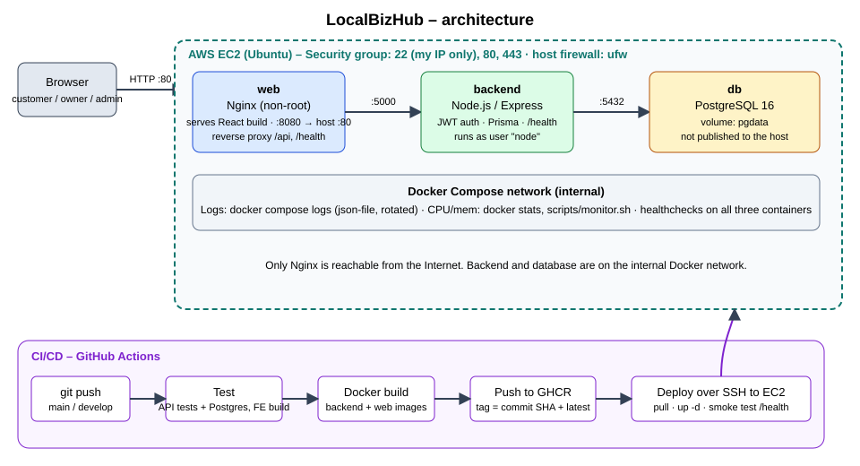
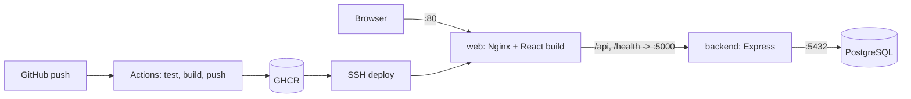

# LocalBizHub

A small-business marketplace: businesses publish profiles and products, customers discover them and send enquiries, admins approve and monitor. Built and deployed as a DevOps exercise (Docker, Compose, Nginx, GitHub Actions, AWS EC2).

- **Live URL:** `http://<EC2-PUBLIC-IP>`  <!-- TODO: fill in after deploying -->
- **Repository:** `https://github.com/<you>/localbizhub`  <!-- TODO -->

## 1. Project Overview
| Role | Can do |
|---|---|
| Customer | register/login, search, filter by category/location, view profiles and products, submit enquiries |
| Business owner | register/login, manage business profile, add/edit/delete products, manage enquiries |
| Admin | manage users and businesses, approve/reject businesses, manage categories, view enquiries, basic analytics |

New businesses start as `pending` and are invisible to the public until an admin approves them. Endpoint list: [docs/API.md](docs/API.md).

## 2. Architecture



Only Nginx is exposed. The browser calls `/api/...` on the same origin, so there are no CORS or hard-coded host problems.

## 3. Technologies
React 18 + Vite + Tailwind · Node.js 20 + Express · PostgreSQL 16 + Prisma · JWT + bcrypt · Docker + Compose · Nginx (unprivileged) · GitHub Actions + GHCR · AWS EC2 (Ubuntu).

## 4. Local Setup (without Docker)
```bash
# PostgreSQL running locally with an empty database "localbizhub"
cd backend && cp .env.example .env      # edit DATABASE_URL and JWT_SECRET
npm install && npx prisma db push && npm run db:seed && npm run dev      # API on :5000
cd ../frontend && cp .env.example .env  # set VITE_API_BASE_URL=http://localhost:5000/api
npm install && npm run dev                                              # UI on :5173 (add it to CORS_ORIGIN)
cd ../backend && RUN_DB_TESTS=true npm test                              # tests (DB tests need DATABASE_URL)
```

## 5. Docker Setup (documented port: 8080)
```bash
cp .env.example .env     # set JWT_SECRET, POSTGRES_PASSWORD, ADMIN_PASSWORD
docker compose up --build -d
open http://localhost:8080          # app
curl http://localhost:8080/health   # {"status":"ok","db":"up",...}
docker compose down -v              # stop and delete data
```
Image optimisations: multi-stage builds (build tools and dev dependencies never reach the runtime image), slim/alpine bases, `.dockerignore`, layer-cached dependency installs, non-root users.
Demo logins when `SEED_DEMO_DATA=true`: password `SEED_DEMO_PASSWORD`; `owner1..7@localbizhub.example`, `customer@localbizhub.example`; admin = `ADMIN_EMAIL`/`ADMIN_PASSWORD`.

## 6. CI/CD
`.github/workflows/ci-cd.yml`: **push → test → docker build → push image → deploy**.

| Job | What it does | Fails the pipeline when |
|---|---|---|
| `test-backend` | Postgres service, `prisma db push`, `npm test` (unit, API and full end-to-end flow tests) | any test fails |
| `build-frontend` | `npm ci && npm run build` | build fails |
| `docker` | builds backend and web images; on `main` pushes to GHCR tagged with the commit SHA and `latest` | a Dockerfile fails to build |
| `deploy` (main only) | SSH to EC2, `docker compose pull && up -d`, then curls `/health` through Nginx | the site is down or returns 5xx |

`docker` needs both test jobs and `deploy` needs `docker`, so a failing test stops everything after it. Pull requests run tests and build images without pushing or deploying.

Repository secrets (Settings → Secrets and variables → Actions): `EC2_HOST`, `EC2_USER`, `EC2_SSH_KEY` (private key), `GHCR_PULL_TOKEN` (PAT with `read:packages`; not needed if you make the packages public). Create a `production` environment (optional manual approval). Branching: [docs/GIT_WORKFLOW.md](docs/GIT_WORKFLOW.md).

## 7. Cloud Deployment (AWS EC2)
Step by step with security-group rules: [docs/DEPLOYMENT_AWS.md](docs/DEPLOYMENT_AWS.md). Summary: launch Ubuntu EC2 → `deploy/ec2-setup.sh` → create `~/localbizhub/.env` → push to `main` → the pipeline deploys.

## 8. Environment Variables
| Variable | Purpose |
|---|---|
| `JWT_SECRET` | signs login tokens, 32+ chars, **required** |
| `JWT_EXPIRES_IN` | token lifetime (default `7d`) |
| `POSTGRES_USER` / `POSTGRES_PASSWORD` / `POSTGRES_DB` | database credentials (`DATABASE_URL` is built from them) |
| `CORS_ORIGIN` | allowed browser origin(s), comma-separated (the public URL) |
| `HTTP_PORT` | local published port (default 8080) |
| `ADMIN_NAME` / `ADMIN_EMAIL` / `ADMIN_PASSWORD` | first admin, created at startup if absent |
| `SEED_DEMO_DATA` / `SEED_DEMO_PASSWORD` | sample businesses and logins (use `false` in production) |
| `VITE_API_BASE_URL` / `VITE_DEMO_MODE` | frontend build args (`/api`, `false`) |

The backend `PORT` is fixed at 5000 in Compose because Nginx's upstream points at it (see the troubleshooting report). Real values live only in `.env` (git-ignored) and GitHub secrets.

## 9. Monitoring / Logging
- **Health:** `GET /health` returns 200 `{status:"ok",db:"up"}` or 503 when the database is unreachable. Every container also has a Docker `HEALTHCHECK`.
- **Logs:** `docker compose logs -f web backend db` (Nginx access log includes upstream address and status, plus its error log). JSON-file logging is rotated (10 MB × 3).
- **CPU / memory:** `docker stats`, or `./scripts/monitor.sh [compose-file]` for state, CPU/memory, health, host disk/memory and recent 4xx/5xx in one view. Host: `htop`, `free -m`, `df -h`.

## 10. Troubleshooting
Scenario "502 Bad Gateway after a deployment": [docs/TROUBLESHOOTING_REPORT.md](docs/TROUBLESHOOTING_REPORT.md). Reproduce with `./scripts/simulate-502.sh break | diagnose | fix`.

Quick checks: `docker compose ps` → `docker compose logs --tail=50 web backend` → `curl -i localhost:8080/health`.

## 11. Security
- No secrets in git: `.env` is ignored; production secrets are in the server `.env` and GitHub Actions secrets.
- Containers run as non-root (`node` user; `nginx-unprivileged`); Postgres uses its own unprivileged user.
- Only Nginx is published; the API and database have no host ports.
- AWS security group: 22 from my IP only, 80 and 443 from anywhere, everything else closed. Host `ufw` mirrors it. Details in [docs/DEPLOYMENT_AWS.md](docs/DEPLOYMENT_AWS.md).
- API: bcrypt password hashes, JWT with role checks on the server, request validation (zod), rate limits on login/register/enquiries, `helmet` headers, Nginx security headers, `server_tokens off`.
- Admins cannot be created through the API; images are pinned to major versions.

## 12. Future Improvements
Image upload (S3 or a volume; images are URLs today) · HTTPS with Let's Encrypt/certbot · Prisma migrations instead of `db push` · committed lockfile for the backend and `npm ci` · automatic rollback to the previous image tag on a failed deploy · Prometheus + Grafana (or CloudWatch) · reviews that drive ratings · owner and admin dashboards in the React app · Trivy image scanning in CI · Terraform for the EC2 setup.
